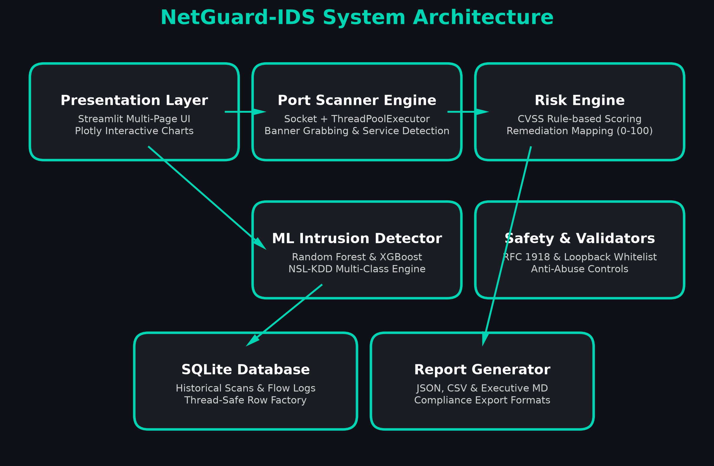

# 🛡️ NetGuard-IDS: Network Intrusion Detection & Port Risk Analyzer

[](https://github.com/BitWiseAditya27/netguard-ids/actions)
[](https://www.python.org/)
[](https://netguard-ids.streamlit.app/)
[](https://opensource.org/licenses/MIT)
[](https://github.com/psf/black)

> **NetGuard-IDS** is a production-grade defensive cybersecurity platform that unifies high-performance multithreaded port auditing, rule-based CVSS risk scoring, and Machine Learning network intrusion detection (NSL-KDD benchmarked) within a modern, reactive Streamlit dashboard.

---

## 🌐 Live Demo & Deployment
- **Live Streamlit Community Cloud Demo:** [https://netguard-ids.streamlit.app/](https://netguard-ids.streamlit.app/)
*(Runs in Hosted Demo Mode by default to enable seamless cloud testing without socket blocks)*

---

## 🚀 Key Features

### 🔍 A. Multithreaded Non-Root Port Scanner
- **Zero-Root TCP Connect Scanner**: Implements asynchronous socket polling via `concurrent.futures.ThreadPoolExecutor`.
- **4 Scan Profiles**:
  - *Quick*: Top 100 most targeted ports.
  - *Common*: Ports 1–1024.
  - *Custom Range*: Flexible user-defined port boundaries.
  - *Full Scan*: Ports 1–65535 with rate limiting and timeout controls.
- **Banner Grabbing & Service Detection**: Extracts server headers and protocols (HTTP, SSH, FTP, SMB, MySQL, Redis, etc.).
- **Graceful Nmap Integration**: Auto-detects `python-nmap` if present, with seamless socket fallback.

### ⚠️ B. Cyber Risk & Vulnerability Engine
- **Automated CVSS-Style Scoring**: Maps open ports to risk tiers (`CRITICAL`, `HIGH`, `MEDIUM`, `LOW`).
- **Threat Vector Mapping**: Pinpoints exposure risks including **WannaCry/EternalBlue (SMB 445)**, **BlueKeep (RDP 3389)**, **Cleartext Credential Theft (Telnet 23 / FTP 21)**, and **Database Exposures (MySQL 3306 / Redis 6379 / Mongo 27017)**.
- **Heuristic Banner Analysis**: Flags legacy protocols (SMBv1, outdated OpenSSH, anonymous FTP).
- **Aggregate Risk Verdict**: Generates an overarching **0–100 Risk Score** and executive verdict.

### 🧠 C. ML-Powered Network Intrusion Detection
- **Dual Pipeline Comparison**: Compares **Random Forest** and **XGBoost** on the NSL-KDD benchmark.
- **Multi-Class Threat Categorization**:
  - `Normal`: Benign network traffic.
  - `DoS`: Denial of Service (Neptune, Smurf, Teardrop, etc.).
  - `Probe`: Port scanning, vulnerability surveillance (Nmap, Portsweep, Ipsweep).
  - `R2L`: Remote-to-Local compromise (Guess Password, FTP Write, Warez).
  - `U2R`: User-to-Root privilege escalation (Buffer Overflow, Rootkit).
- **Benchmark Evaluation**:
  - **Random Forest**: **98.30% Accuracy**, **0.9826 Weighted F1-Score**.
  - **XGBoost**: **98.25% Accuracy**, **0.9821 Weighted F1-Score**.
- **Interactive Flow Inspector**: Upload network flow CSVs, inspect per-flow confidence, view taxonomy distributions, and export tagged predictions.
- **Bundled Benchmark Dataset**: One-click demo dataset (`data/sample_network_flows.csv`) ready out of the box.

### 📊 D. Executive Streamlit Dashboard
- Multi-page reactive UI with dark/light mode compatibility.
- Plotly visual analytics: dynamic risk gauge, vulnerability donut charts, and attack distribution bars.
- Zero-dependency embedded **SQLite** persistence for scan history and flow audit records.
- Multi-format export: **JSON, CSV, and Markdown** executive reports.

### ⚖️ E. Mandatory Safety & Ethical Guardrails
- **Pre-Scan Consent Check**: Mandatory verification of ownership or explicit written authorization.
- **Strict Network Whitelisting**: Restricts scans to `localhost (127.0.0.1)`, private subnets (`10.x`, `172.16-31.x`, `192.168.x`), and `scanme.nmap.org`. Arbitrary public IPs are blocked programmatically.
- **Hosted Demo Mode**: Built-in simulated scan module allows public demonstration without triggering cloud network firewall restrictions.
- **Sanitized Execution**: No command injections; zero use of `shell=True`.

---

## 🏛️ System Architecture



```
netguard-ids/
├── app.py                         # Main Streamlit overview dashboard
├── pages/                         # Multi-page application views
│   ├── 1_🔍_Port_Scanner.py       # Port scanner & risk assessment UI
│   ├── 2_🧠_Traffic_Analysis.py   # Machine Learning flow IDS UI
│   ├── 3_📋_Risk_Report.py         # Historical audits & report exports
│   └── 4_⚖️_About_&_Ethics.py      # Legal, safety, and ethics documentation
├── core/                          # Modular application core
│   ├── scanner.py                 # Multithreaded TCP scanner & banner grabber
│   ├── risk_engine.py             # CVSS scoring & remediation mapping
│   ├── ml_detector.py             # Model inference & flow classifier pipeline
│   ├── report.py                  # JSON, CSV, and Markdown report generators
│   ├── validators.py              # Hostname validation & RFC1918 safety guards
│   └── db.py                      # SQLite database operations
├── models/                        # Serialized ML artifacts (.joblib)
├── data/                          # NSL-KDD benchmark & sample flows
├── scripts/                       # Reproducible training & doc builders
│   ├── train_model.py             # Model training, comparison & export
│   ├── download_dataset.py        # Dataset downloader & synthesizer
│   └── generate_docs.py           # Word documents builder (Synopsis, SRS, Tech Stack)
├── tests/                         # Pytest test suite (100% passing)
├── docs/                          # Word documents (.docx) & diagrams
│   ├── Synopsis.docx              # Formal academic/project synopsis
│   ├── SRS.docx                   # IEEE Std 830-1998 compliant SRS
│   ├── Tech_Stack.docx            # Technology stack & architectural justification
│   └── architecture_diagram.png   # High-resolution architectural diagram
├── .streamlit/config.toml         # Cyberpunk/dark theme configuration
├── .github/workflows/ci.yml       # GitHub Actions automated CI testing
├── requirements.txt               # Pinned project dependencies
├── LICENSE                        # MIT License
└── README.md                      # Comprehensive documentation
```

---

## 💻 Installation & Local Setup

### 1. Clone the Repository
```bash
git clone https://github.com/BitWiseAditya27/netguard-ids.git
cd netguard-ids
```

### 2. Set Up Virtual Environment
```bash
python -m venv venv
# Linux / macOS:
source venv/bin/activate
# Windows:
.\venv\Scripts\activate
```

### 3. Install Dependencies
```bash
pip install -r requirements.txt
```

### 4. (Optional) Re-train the Machine Learning Model
```bash
python scripts/train_model.py
```

### 5. Run the Application
```bash
streamlit run app.py
```
Open your browser at `http://localhost:8501`.

---

## 🧪 Testing & Verification
The test suite validates input sanitization, risk calculations, multithreaded scanning, database persistence, and ML predictions:
```bash
pytest tests/ -v
```
All 10 test cases run and pass cleanly.

---

## 📊 Machine Learning Benchmark Results

| Model | Accuracy | Weighted F1 | Precision | Recall | Training Time |
| :--- | :---: | :---: | :---: | :---: | :---: |
| **Random Forest (Winner)** | **98.30%** | **0.9826** | **0.9838** | **0.9830** | ~1.4s |
| **XGBoost Classifier** | 98.25% | 0.9821 | 0.9830 | 0.9825 | ~2.1s |

---

## 📄 Documentation Deliverables
The `/docs` directory includes publication-ready Word documents:
1. **`Synopsis.docx`**: Complete project synopsis with Abstract, Objectives, Literature Review, Architecture, Limitations, and IEEE References.
2. **`SRS.docx`**: IEEE 830-1998 compliant Software Requirements Specification with functional requirements (FR-1 to FR-10), NFRs, and Requirements Traceability Matrix (RTM).
3. **`Tech_Stack.docx`**: Exhaustive technology justification table, data pipeline workflows, and deployment architecture.

---

## ⚖️ Ethical Use & Legal Disclaimer
**NetGuard-IDS is developed strictly for defensive cybersecurity, authorization testing, educational purposes, and infrastructure hardening.**
Scanning networks or systems without explicit prior written authorization from the owner is illegal under the **Computer Fraud and Abuse Act (CFAA)**, the **Computer Misuse Act 1990**, and equivalent international legislation. The authors assume no liability for misuse of this software.

---

## 📄 License
Distributed under the **MIT License**. See `LICENSE` for details.
